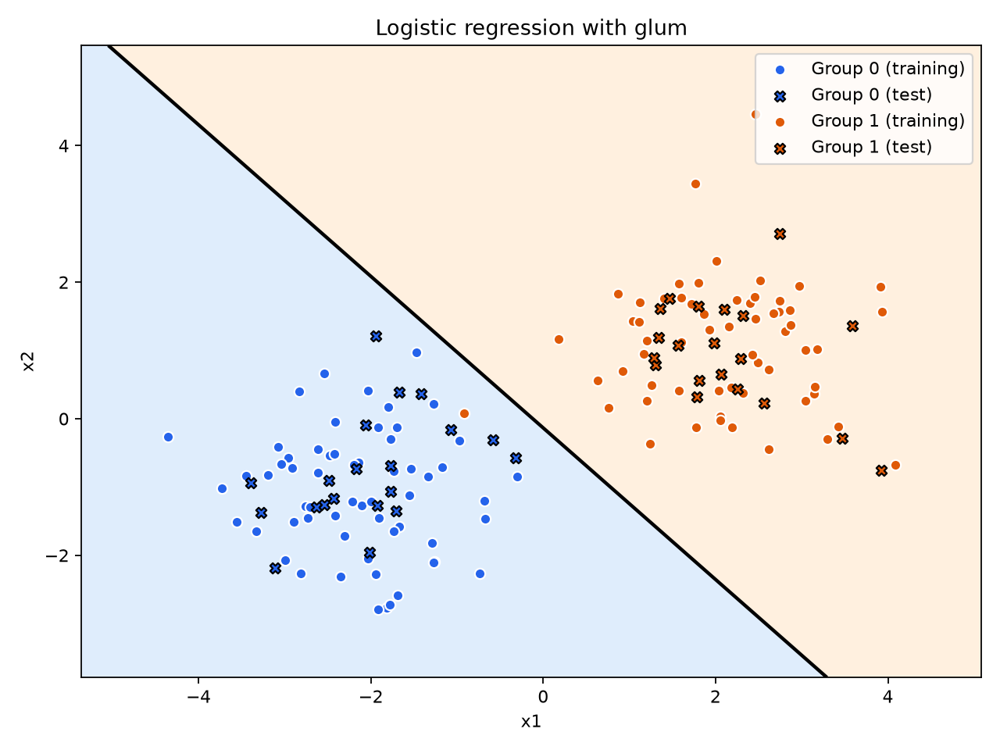

# Classifying points with glum

[SVMglum.py](SVMglum.py) fits a logistic regression model to two groups of points using [QuantCo's glum](https://github.com/Quantco/glum). For any point in the plane, the model estimates its probability of belonging to group 1. Along the black line in the plot, that probability is exactly 50%.



With the default seed, the model gets all 40 test points right. For a package called *glum*, it has surprisingly little to be sad about.

## Run on Windows

Open a terminal in the folder containing `SVMglum.py` and run these commands with Python 3.11 installed.

```powershell
py -3.11 -m venv .venv
.\.venv\Scripts\python.exe -m pip install -r requirements.txt
.\.venv\Scripts\python.exe SVMglum.py
```

For IDLE, launch `.\.venv\Scripts\python.exe -m idlelib SVMglum.py` and press **F5**. For a terminal run that only saves the plot, add `--no-show` to the script command.

## Read the result

The script generates 160 labeled points with a fixed seed. It fits the model on 120 points (circles) and checks its predictions on 40 held-out points (crosses). It also prints the predicted probability and group for `[1.5, 1.0]`. Change `new_point` to classify another location, or increase `cluster_std` to see how the classifier behaves when the groups overlap.

## Stanford course notes

This example draws a straight boundary using the two original coordinates. To explore how a change of coordinates can produce a curved boundary in the original plane, see Andrew Ng's Stanford CS229 lecture notes on [Kernel Methods](https://cs229.stanford.edu/summer2019/cs229-notes3.pdf), updated by Tengyu Ma. Section 1.1 introduces the idea of a feature map.
